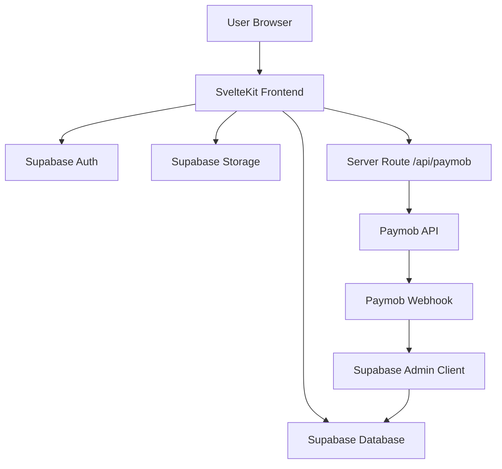

# V League Platform

V League is a modern athletics and competition platform built to bring the energy of elite sport into one polished digital experience. It connects fans, athletes, and organizers through a live league presence that showcases standings, featured athletes, upcoming competitions, media coverage, and direct event registration.

This project is designed as a league-facing web experience: a branded home for performance, results, and participation.

## What this project is

At its core, this platform is a digital home for a competitive athletics league. It gives the league a public-facing presence where users can:

- browse live rankings and competition standings
- discover athletes and competition records
- explore upcoming events and event details
- register for competitions and pay through a secure merchant flow
- read blog and media content
- manage personal profiles and authenticated sessions
- access a clear, mobile-ready experience built for fans and competitors alike

The product blends editorial storytelling, sport data, commerce, and user accounts into a single experience.

## Product experience

The experience is designed around speed, performance, and spectacle. The homepage presents a high-energy hero section, standing tables, upcoming events, featured athletes, and media storytelling. The navigation and page structure are focused on creating a premium sports brand while keeping the interface fast and easy to browse.

The app is structured so that public-facing content stays accessible and fast, while authenticated flows such as profile editing, competition registration, and payment confirmation are handled through secure server-side logic.

## Core features

### Public league experience
- dynamic home page with hero, standings, featured athlete, media, and event highlights
- athlete directory with profile pages
- blog/news section with article cards and individual post pages
- competition list and detail pages with schedule, status, and event information
- media-rich competition presentation

### Competition registration
- authenticated users can register for competition events
- event selection is validated against the competition before checkout
- pricing and eligibility are pulled server-side instead of trusting client input
- payment flow is created through a Paymob integration and confirmed via webhook handling

### Authentication and profiles
- Supabase auth powers sign-in and sign-up flows
- user profiles are stored and updated through centralized helpers
- protected routes keep access controlled with shared auth checks
- users can edit profile details and media through a dedicated profile screen

### Rankings and data-driven experience
- live leaderboard-style presentation for standings
- athlete and event data are loaded from Supabase and rendered in a clean, readable format
- logic is separated into reusable query and formatting utilities to keep the frontend consistent

## Tech stack

This project is built with a modern SvelteKit stack:

- SvelteKit for routing, SSR, and app structure
- Svelte 5 for component-driven UI
- Tailwind CSS for styling and layout
- Supabase for authentication, database access, and storage
- Paymob for registration payment processing and webhooks
- Netlify adapter for deployment-friendly builds

## Project structure

```text
src/
  lib/
    auth.js                  # session helpers and auth gate logic
    profile.js               # profile save/update logic
    supabase.js              # Supabase client configuration
    supabaseData.js          # reusable query wrappers and fallback handling
    server/
      paymob.js              # Paymob API and webhook verification functions
    components/
      CompetitionEventTable.svelte
      layout/
      ui/
    sections/
      home/
      shared/
    utils/
      competitionRegistration.js
      markdown.js
      rankingAlgo.js
      ui.js
  routes/
    +layout.js
    +layout.svelte
    api/
      paymob/
        create-intention/
        webhook/
    athletes/
    auth/
    blog/
    competitions/
    contact/
    profile/
    ranking/
```

## Environment configuration

This app expects a Supabase project and Paymob configuration in your environment.

Create a `.env` file in the project root with values similar to:

```env
PUBLIC_SUPABASE_URL=https://your-project.supabase.co
PUBLIC_SUPABASE_ANON_KEY=your-anon-key
SUPABASE_SERVICE_ROLE_KEY=your-service-role-key

PAYMOB_SECRET_KEY=your-paymob-secret-key
PAYMOB_PUBLIC_KEY=your-paymob-public-key
PAYMOB_INTEGRATION_ID=123456,123457
PAYMOB_HMAC_SECRET=your-hmac-secret
PAYMOB_BASE_URL=https://accept.paymob.com
```

### Notes
- `PUBLIC_*` values are exposed to the browser and are intended for non-sensitive frontend usage.
- `SUPABASE_SERVICE_ROLE_KEY` and Paymob secrets are server-side variables and must never be exposed in the client.
- The Paymob integration is used for checkout creation and webhook verification, which keeps payment validation server-authenticated.

## Local development

Install dependencies:

```bash
npm install
```

Start the app locally:

```bash
npm run dev
```

Or open the browser directly:

```bash
npm run dev -- --open
```

## Production build

Run the production build:

```bash
npm run build
```

Preview the built app locally:

```bash
npm run preview
```

## Quality checks

The project includes Svelte validation tooling:

```bash
npm run check
```

This is useful for detecting broken components or invalid Svelte code during development.

## Expected data model

The application is designed around a Supabase-backed sports platform. Typical tables include entities such as:

- `profiles` for user identity and account data
- `competitions` for league event metadata
- `competition_events` for event-level schedules and pricing
- `registrations` for participant registrations and payment linking
- `blogs` for articles and content updates
- `athlete` or related profile data used in rankings and athlete pages

The app uses a mix of direct table queries and helper functions to keep data access centralized and consistent.

## Deployment

This project is configured to work with a SvelteKit deployment workflow, including Netlify-oriented adapter support. The app is built as a modern web product with a static-friendly frontend and server endpoints for secure payment and auth operations.

In production, you should:

- configure the environment variables in your hosting provider
- connect your Supabase project and storage buckets
- configure Paymob webhook URLs and allowed callback endpoints
- verify your auth redirect URIs and public hosting domain

## Why this project matters

This is more than a demo or template—it is a real league platform concept built for the way modern sports communities consume content and participate in competition. It brings together the digital experience of a premium sports brand with the operational realities of event registration, auth, data, and monetization.

The goal is simple: make the league feel alive, current, and premium from the first click to the moment someone registers for an event.

## License

This project is intended for internal product and platform development. Review the repository settings and legal requirements before public release or commercial distribution.

---

Built for a modern athletics league experience, shaped around performance, participation, and community.

---

# Supabase Backend Architecture

This project uses Supabase as the core backend foundation for authentication, database access, storage, and secure registration workflows. The app is built in SvelteKit, and Supabase is handling the live backend logic that powers the league platform.

## High-level overview

The backend architecture follows this pattern:

- the browser app uses a public Supabase client for read-only browsing
- authenticated routes and protected actions rely on server-side validation
- sensitive operations are handled through SvelteKit server endpoints
- payment confirmation is verified through Paymob webhooks before final registration status is updated
- Supabase is the system of record for user accounts, competition content, registrations, and uploaded media



## 1) Authentication in Supabase

The app initializes a shared Supabase client in [src/lib/supabase.js](src/lib/supabase.js). This client enables persistent login sessions and automatic token refresh in the browser.

The authentication helpers in [src/lib/auth.js](src/lib/auth.js) are responsible for:

- checking the current session
- determining whether a user is logged in
- redirecting unauthorized users away from protected pages
- keeping auth logic centralized across the app

This is how the platform manages access for:
- profile editing
- registration flows
- protected competition actions
- member-specific experiences

The auth UI is built around Supabase sign-in and sign-up flows at [src/routes/auth/+page.svelte](src/routes/auth/+page.svelte) and [src/lib/sections/shared/AuthForm.svelte](src/lib/sections/shared/AuthForm.svelte).

### What Supabase Auth does here
Supabase Auth provides:
- email/password authentication
- session persistence in the browser
- access tokens for protected requests
- user identity for authorization checks

## 2) Database layer

The project uses Supabase as the main relational database backend. Data access is centralized in [src/lib/supabaseData.js](src/lib/supabaseData.js), which wraps Supabase queries and adds safer fallback behaviors for missing data.

The app queries tables such as:

- profiles
- competitions
- competition_events
- registrations
- blogs
- athlete-related records for ranking and athlete detail pages

Examples of database-driven pages include:

- [src/routes/competitions/+page.js](src/routes/competitions/+page.js)
- [src/routes/competitions/[id]/+page.js](src/routes/competitions/[id]/+page.js)
- [src/routes/athletes/+page.js](src/routes/athletes/+page.js)
- [src/routes/blog/+page.js](src/routes/blog/+page.js)
- [src/routes/ranking/+page.js](src/routes/ranking/+page.js)

These pages fetch information from Supabase and render it into the UI.

### Typical data model used by this app
The app is clearly designed around a sports platform schema such as:

- profiles: user profile and identity data
- competitions: event metadata, date, location, status
- competition_events: event details, schedules, pricing, eligibility
- registrations: which user registered for which event
- blogs: articles, excerpts, metadata, media
- athlete data: leaderboard and athlete profile information

This is a classic Supabase pattern: the database stores structured application data, while Svelte pages request only the fields they need.

## 3) Server-side backend logic

This project does not trust the browser for sensitive actions. It moves critical logic into SvelteKit server routes.

The key backend files are:

- [src/routes/api/paymob/create-intention/+server.js](src/routes/api/paymob/create-intention/+server.js)
- [src/routes/api/paymob/webhook/+server.js](src/routes/api/paymob/webhook/+server.js)
- [src/lib/server/paymob.js](src/lib/server/paymob.js)

These files perform:
- user verification
- competition validation
- price validation from the database
- payment intention creation
- webhook verification
- secure database writes after payment events

This is an important backend design decision. It keeps the client browser thin and ensures the server is the trusted authority.

## 4) Supabase admin client

The project uses a server-side Supabase admin client in [src/lib/server/paymob.js](src/lib/server/paymob.js). This uses the service-role key and is intentionally only available on the server.

That admin client is used for:

- reading protected data
- creating registration records
- writing payment-related updates
- verifying secure operations outside of browser-level access

This pattern is essential because:
- browser clients should not have full database write access
- payment flow and registration logic need trusted server validation
- row-level security can still be enforced for normal users

## 5) Payment flow and database interaction

The registration flow is an example of how Supabase and external services work together.

### Step-by-step flow
1. A logged-in user selects competition events.
2. The frontend calls the server route for Paymob intent creation.
3. The server validates the user token with Supabase Auth.
4. The server checks the selected event IDs against the correct competition.
5. It fetches the real event pricing and competition details from Supabase.
6. It creates a Paymob intention and returns the checkout URL.
7. The user completes the payment.
8. Paymob sends a webhook callback.
9. The server verifies the webhook HMAC signature.
10. The server updates the registration/payment status in Supabase.

This is a strong backend pattern because the database is not being modified by raw browser requests. It is updated only after server-side checks and trusted external confirmation.

## 6) Storage and media

Supabase Storage is used for profile and media assets, especially in [src/routes/profile/edit/+page.svelte](src/routes/profile/edit/+page.svelte).

This means Supabase is also handling:
- image uploads
- profile media
- media-backed athlete or competition assets
- cloud-hosted files that are referenced by the app

This makes Supabase a full backend platform rather than just a database.

## 7) Why this backend setup is strong

This project has a solid backend structure because it separates concerns cleanly:

- Supabase Auth handles identity and sessions
- Supabase Database stores structured app data
- Supabase Storage handles media
- SvelteKit server routes handle protected business logic
- Paymob handles payments
- webhook verification protects against tampering and fraudulent updates

This is exactly the kind of architecture you want for a real product with:
- user accounts
- competition registration
- payments
- events and rankings
- protected admin-level operations

## 8) In simple terms

Supabase is the app’s backend engine.

It powers:
- who can log in
- what data exists
- which users are registered
- what competitions are live
- how media is stored
- how secure payment data is tracked and confirmed

The server routes make sure all of that is validated correctly before changes are committed.

## 9) Recommended next step

If you want, I can turn this into:
1. a more formal backend documentation page for your project, or
2. a database schema blueprint showing the exact tables and columns this app likely needs.
