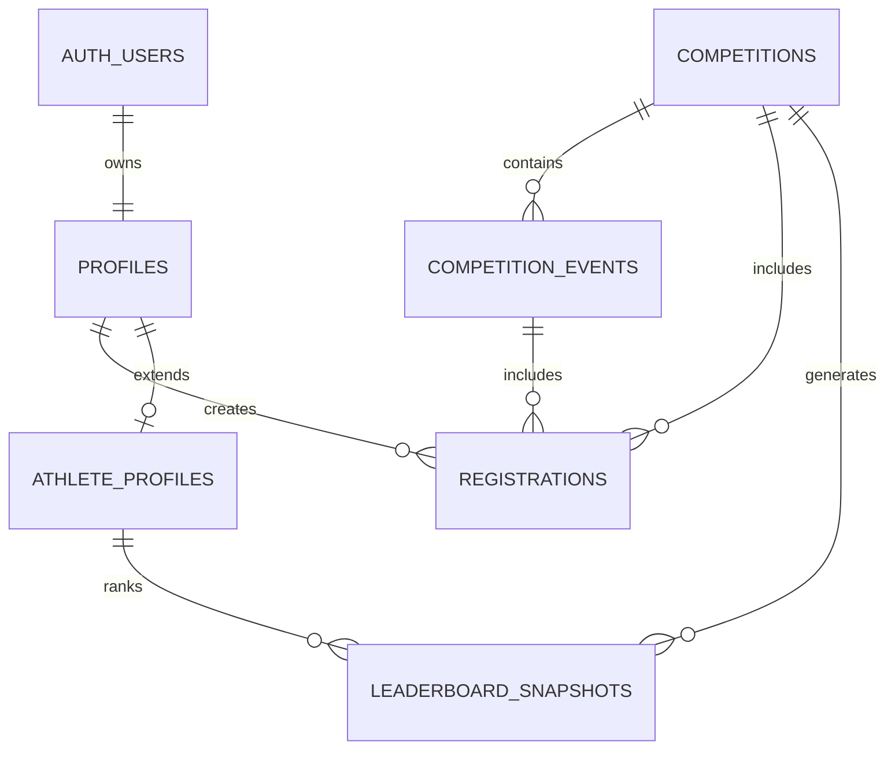

# Supabase Backend Specification

This document defines the recommended Supabase database schema and backend architecture for the V League platform based on the existing app structure and usage patterns. It is intended as a technical implementation spec for the project’s authentication, competition, ranking, profiles, payments, and content model.

## 1. Overview

The application uses Supabase as its primary backend infrastructure for:

- authentication and session management
- user profile data
- competition and event data
- rankings and athlete discovery
- registration records and payment tracking
- blog/media content
- storage of profile and content images

The app follows a secure pattern where public data is read directly from Supabase, while sensitive operations such as registration, payment intent creation, and post-payment updates are validated on the server before database writes are made.

---

## 2. Core backend principles

1. Public frontend reads should remain lightweight and fast.
2. Protected operations must happen through server-side logic.
3. User-owned records should be enforced with Row-Level Security (RLS).
4. Payment and registration writes should only happen after validation and webhook verification.
5. Database access should be centralized and not scattered across components.

---

## 3. High-level data model

The platform revolves around a small set of core entities:

- profiles: authenticated users and public athlete identity
- competitions: league events or tournament entries
- competition_events: specific race or category-level sessions inside a competition
- registrations: user event registrations and trackable payment status
- blogs: articles and editorial content
- athlete_profiles or related athlete metadata: public athlete records and bio information
- storage objects: uploaded images and media files

---

## 4. Suggested table schema

The following schema reflects the actual patterns used by this app and should be implemented in Supabase Postgres.

### 4.1. profiles

```sql
create table public.profiles (
  id uuid primary key references auth.users(id) on delete cascade,
  full_name text,
  username text unique,
  email text,
  bio text,
  avatar_url text,
  country text,
  is_athlete boolean not null default false,
  created_at timestamptz not null default now(),
  updated_at timestamptz not null default now()
);
```

#### Purpose
- stores profile information for authenticated users
- links profile data to the Supabase auth user record
- supports athlete and organizer identities

#### Notes
- `id` should match the authenticated user ID from Supabase Auth.
- `username` should be unique for public athlete and profile discovery.

---

### 4.2. competitions

```sql
create type public.competition_status as enum (
  'draft',
  'upcoming',
  'open',
  'closed',
  'cancelled'
);

create table public.competitions (
  id uuid primary key default gen_random_uuid(),
  title text not null,
  slug text not null unique,
  location text,
  event_date timestamptz,
  status public.competition_status not null default 'upcoming',
  ticket_price numeric(10,2) not null default 0,
  description text,
  image_url text,
  media jsonb not null default '[]'::jsonb,
  created_at timestamptz not null default now(),
  updated_at timestamptz not null default now()
);
```

#### Purpose
- defines each competition or league event
- holds public metadata and display content
- drives competition cards, detail pages, and registration eligibility

#### Notes
- `media` can store arrays of image or video objects for rich detail pages.
- `ticket_price` may be used for general entry/registration pricing.

---

### 4.3. competition_events

```sql
create type public.event_status as enum (
  'scheduled',
  'open',
  'closed',
  'cancelled'
);

create table public.competition_events (
  id uuid primary key default gen_random_uuid(),
  competition_id uuid not null references public.competitions(id) on delete cascade,
  name text not null,
  gender text,
  age_category text,
  round_type text,
  scheduled_at timestamptz,
  status public.event_status not null default 'scheduled',
  price numeric(10,2) not null default 0,
  registration_open boolean not null default false,
  created_at timestamptz not null default now(),
  updated_at timestamptz not null default now()
);
```

#### Purpose
- stores specific track or field event instances within each competition
- contains pricing, schedule, and registration state
- supports event-level registration selection

#### Notes
- the app expects users to register for one or more `competition_events` under a parent `competition`.
- event eligibility is validated against the competition before payment is created.

---

### 4.4. registrations

```sql
create type public.registration_status as enum (
  'pending',
  'paid',
  'failed',
  'cancelled',
  'refunded'
);

create table public.registrations (
  id uuid primary key default gen_random_uuid(),
  profile_id uuid not null references public.profiles(id) on delete cascade,
  competition_id uuid not null references public.competitions(id) on delete cascade,
  competition_event_id uuid not null references public.competition_events(id) on delete cascade,
  order_id text unique,
  paymob_transaction_id text,
  amount_cents integer not null default 0,
  currency text not null default 'EGP',
  status public.registration_status not null default 'pending',
  created_at timestamptz not null default now(),
  updated_at timestamptz not null default now(),
  unique (profile_id, competition_event_id)
);
```

#### Purpose
- tracks which user registered for which event
- stores payment status and order identity
- supports conflict prevention against duplicate event registration

#### Notes
- `order_id` should be unique and mapped to Paymob order data.
- `status` is the source of truth for confirmation and onboarding workflows.
- a registration should generally be considered a single event entry, with the competition relation for reporting and grouping.

---

### 4.5. blogs

```sql
create table public.blogs (
  id uuid primary key default gen_random_uuid(),
  slug text not null unique,
  title text not null,
  excerpt text,
  content text not null,
  image_url text,
  author text not null default 'V League',
  published_at timestamptz not null default now(),
  created_at timestamptz not null default now(),
  updated_at timestamptz not null default now()
);
```

#### Purpose
- stores article content for the league media/news section
- powers blog listing and blog detail pages
- supports editorial publishing with metadata and images

---

### 4.6. athlete_profiles

```sql
create table public.athlete_profiles (
  id uuid primary key references public.profiles(id) on delete cascade,
  sport text not null default 'Athletics',
  team_name text,
  country text,
  personal_best text,
  headline text,
  bio text,
  image_url text,
  created_at timestamptz not null default now(),
  updated_at timestamptz not null default now()
);
```

#### Purpose
- adds athlete-specific metadata beyond the base profile
- supports athlete directory and athlete detail pages
- keeps performance and identity data separate from the core auth identity

---

### 4.7. ranking snapshots or leaderboard data

The app includes ranking logic and leaderboard display, so a separate table is helpful for storing calculated leaderboard snapshots:

```sql
create table public.leaderboard_snapshots (
  id uuid primary key default gen_random_uuid(),
  athlete_id uuid not null references public.athlete_profiles(id) on delete cascade,
  competition_id uuid references public.competitions(id) on delete set null,
  rank_position integer,
  points numeric(10,2) not null default 0,
  score jsonb,
  generated_at timestamptz not null default now()
);
```

#### Purpose
- preserves historical ranking values
- allows standings pages to render from a stable, queryable dataset
- supports score/rank recalculation without destroying public data immediately

---

## 5. Indexes

Recommended indexes for performance:

```sql
create index idx_competitions_status on public.competitions(status);
create index idx_competitions_event_date on public.competitions(event_date);
create index idx_competition_events_competition_id on public.competition_events(competition_id);
create index idx_competition_events_scheduled_at on public.competition_events(scheduled_at);
create index idx_registrations_profile_id on public.registrations(profile_id);
create index idx_registrations_competition_event_id on public.registrations(competition_event_id);
create index idx_registrations_status on public.registrations(status);
create index idx_blogs_published_at on public.blogs(published_at desc);
create index idx_blog_slug on public.blogs(slug);
create index idx_leaderboard_snapshots_athlete_id on public.leaderboard_snapshots(athlete_id);
create index idx_leaderboard_snapshots_generated_at on public.leaderboard_snapshots(generated_at desc);
```

---

## 6. Row-Level Security (RLS)

RLS should be enabled on all user-facing tables.

### 6.1. profiles

```sql
alter table public.profiles enable row level security;

create policy "Users can view public profiles"
on public.profiles for select
using (true);

create policy "Users can update their own profile"
on public.profiles for update
using (auth.uid() = id)
with check (auth.uid() = id);

create policy "Users can insert their own profile"
on public.profiles for insert
with check (auth.uid() = id);
```

### 6.2. competitions

```sql
alter table public.competitions enable row level security;

create policy "Anyone can view competitions"
on public.competitions for select
using (true);
```

### 6.3. competition_events

```sql
alter table public.competition_events enable row level security;

create policy "Anyone can view competition events"
on public.competition_events for select
using (true);
```

### 6.4. registrations

```sql
alter table public.registrations enable row level security;

create policy "Users can view their own registrations"
on public.registrations for select
using (auth.uid() = profile_id);

create policy "Users can insert their own registrations"
on public.registrations for insert
with check (auth.uid() = profile_id);

create policy "Users can update their own registrations"
on public.registrations for update
using (auth.uid() = profile_id)
with check (auth.uid() = profile_id);
```

### 6.5. blogs

```sql
alter table public.blogs enable row level security;

create policy "Anyone can view blogs"
on public.blogs for select
using (true);
```

### 6.6. athlete_profiles

```sql
alter table public.athlete_profiles enable row level security;

create policy "Anyone can view athlete profile records"
on public.athlete_profiles for select
using (true);

create policy "Users can update their athlete profile"
on public.athlete_profiles for update
using (auth.uid() = id)
with check (auth.uid() = id);
```

> In production, privileged admin operations should be handled by server-side service-role access, not direct client-side writes.

---

## 7. Triggers and timestamps

Use a simple trigger to maintain `updated_at` values automatically.

```sql
create or replace function public.update_updated_at_column()
returns trigger as $$
begin
  new.updated_at = now();
  return new;
end;
$$ language plpgsql;
```

Then attach it to the relevant tables:

```sql
create trigger set_profiles_updated_at
before update on public.profiles
for each row
execute function public.update_updated_at_column();

create trigger set_competitions_updated_at
before update on public.competitions
for each row
execute function public.update_updated_at_column();

create trigger set_competition_events_updated_at
before update on public.competition_events
for each row
execute function public.update_updated_at_column();

create trigger set_registrations_updated_at
before update on public.registrations
for each row
execute function public.update_updated_at_column();
```

---

## 8. Storage buckets

The app should use storage buckets for media content. Recommended buckets:

- `avatars`
- `competition-images`
- `blog-images`
- `media`

Example bucket setup:

```sql
-- example bucket names in Supabase dashboard or via storage API
-- avatars: private or public depending on project design
-- competition-images: public read
-- blog-images: public read
-- media: public read
```

Recommended storage policies:
- users can upload their own avatars
- public content images can be read by everyone
- blog and competition media should be public or at least read-visible
- uploads should be validated for size and file type on the app side

---

## 9. Data relationship map



---

## 10. Business rules enforced in backend

These are the rules the backend should enforce before allowing writes:

### Profiles
- a user profile must exist before registration actions are allowed
- usernames must be unique
- profile updates should belong only to the authenticated owner

### Competitions
- competition status drives whether users can register
- date and location must be set before publication
- pricing can be validated server-side when creating intent requests

### Competition events
- each event belongs to exactly one competition
- registration must be blocked if the event is not open
- event participation should validate the correct competition linkage

### Registrations
- a user cannot register twice for the same event
- price must be pulled from the server and not trusted from the client
- payment status must resolve to `pending`, `paid`, `failed`, or `cancelled`
- webhook confirmation should update a registration only after trusted validation

### Blogs
- published content should have slug and title
- article metadata should remain queryable and stable

---

## 11. Server-side security design

This project already follows a strong security pattern:

- browser client uses public Supabase keys for read-only interactions
- private and server-sensitive values are kept in environment variables
- service-role key is used only on the server
- Paymob webhook validation happens on the server before modifying data
- registration writes are validated against database state rather than trusting incoming client data

This means the database is protected by both:
- application-layer validation
- row-level security
- server-only admin operations

---

## 12. Recommended Supabase setup checklist

Before production launch, the following should be configured:

- enable Auth for email/password sign-in
- create and enable RLS on all application tables
- create storage buckets for avatars and media
- configure environment variables for Supabase and Paymob
- create server routes for secure payment and registration
- add webhook endpoint configuration in Paymob
- verify redirect URLs for auth flows and callbacks
- add database indexes for ranking, registration, and competition queries

---

## 13. Example implementation summary

The app is effectively structured around these database responsibilities:

- `profiles` for identity
- `competitions` and `competition_events` for event data
- `registrations` for entrants and payment state
- `blogs` for media/news content
- `athlete_profiles` and leaderboard tables for athlete discovery and rankings
- `storage` for uploaded media and user profile assets

This database design supports the platform’s actual use cases: public browsing, athlete exposure, competition listing, registration, payments, and editorial content.

---

## 14. Final recommendation

The recommended production architecture is:

1. use Supabase Auth for user identity
2. use Supabase Postgres for all structured data
3. use Supabase Storage for images/media
4. keep all sensitive writes on server routes
5. validate Paymob payment state with webhook verification before final registration confirmation
6. use RLS to protect user-owned records while leaving public content readable

This structure is aligned with the current app architecture and should support a scalable, secure athletics league platform.
